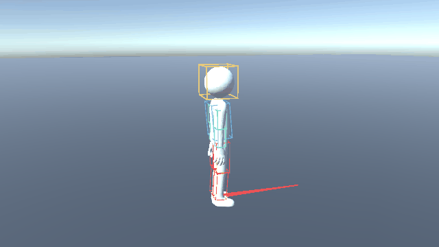

# Server-authoritative Bob WalkForward

Unity 클라이언트는 **WASD 입력만 서버로 전송**하고, .NET 서버가 캐릭터 이동·전체 본 포즈·히트박스를 계산해 스냅샷으로 돌려주는 서버 권위 애니메이션 POC입니다.



`StickManFight`의 Bob 캐릭터와 실제 Mixamo 걷기 FBX를 사용합니다.
Unity 에디터가 FBX를 오프라인으로 샘플링하면, .NET 서버가 전체 본 포즈와 부위별 히트박스를 계산합니다.
실행 중인 Unity 클라이언트는 WASD 벡터만 전송하고 서버 포즈를 Bob 스킨 메시와 히트박스에 적용합니다.

## 요구 사항

- [.NET 8 SDK](https://dotnet.microsoft.com/download/dotnet/8.0)
- Unity `6000.3.23f1`
- Linux, macOS 또는 Windows 터미널

애니메이션 JSON과 Unity 프리팹은 저장소에 포함되어 있어 최초 실행 시 FBX를 다시 베이크할 필요가 없습니다.

## 빠른 실행

### 1. 저장소 받기

```bash
git clone https://github.com/BaeJiwoo/PoC_ServerAuthoritative_Animation.git
cd PoC_ServerAuthoritative_Animation
```

### 2. 서버 실행

```bash
dotnet run --project src/ServerAuthoritativeAnimation.Server --urls http://127.0.0.1:5000
```

`Now listening on: http://127.0.0.1:5000`이 표시되면 서버가 준비된 것입니다. 다른 터미널에서 상태를 확인할 수도 있습니다.

```bash
curl http://127.0.0.1:5000/
```

### 3. Unity 클라이언트 실행

1. Unity Hub에서 저장소의 `UnityClient` 폴더를 Unity `6000.3.23f1`로 엽니다.
2. 에셋 임포트와 컴파일이 끝나면 상단 메뉴에서 **POC → Run Server-Authoritative Demo**를 선택합니다.
3. Game 뷰를 클릭하고 WASD로 이동합니다.

빈 씬에서 Play를 눌러도 카메라·조명·바닥·Bob·루트 표시가 자동 생성됩니다. 기본 WebSocket 주소는 `ws://127.0.0.1:5000/ws`입니다.

| 입력 | 동작 |
| --- | --- |
| W / S | 월드 `+Z` / `-Z` 방향 이동 |
| A / D | 월드 `-X` / `+X` 방향 이동 |
| 두 키 동시 입력 | 속도가 정규화된 대각선 이동 |
| 키 해제 | 이동과 애니메이션 위상 정지 |

더 자세한 실행·문제 해결·재베이크 절차는 [START_GUIDE.md](START_GUIDE.md)를 참고하세요.

## 사용 에셋

- 모델: 원본 `StickManFight/Assets/Game/Characters/Bob/Models/Bob_Rigged.fbx`
- 걷기: 원본 `StickManFight/Assets/Game/Characters/Bob/Animations/Bob_Walk_Forward.fbx`
- POC 복사본: `UnityClient/Assets/Imported/Bob/`
- 걷기 데이터: `assets/animations/BobWalkForward.json` — 1초, 60프레임, 43개 트랜스폼
- 표시 프리팹: `UnityClient/Assets/Resources/ServerCharacter.prefab`

원본 FBX와 Humanoid 아바타/방향 보정 설정을 복사했으며 원본 프로젝트는 수정하지 않았습니다.
Idle/방향별 애니메이션과 Blend Tree는 사용하지 않습니다. 기준 서기 포즈는 바인드 포즈에서 팔을 내려 만든 정적 포즈입니다.

## 동작 특성

- W/S/A/D: `+Z/-Z/-X/+X`, 대각선 정규화
- 모든 방향에서 루트 전체를 즉시 돌린 뒤 같은 WalkForward 재생
- 무입력: 위치·위상 정지, 정적 서기 포즈 표시
- 서버 20 Hz 스냅샷, 입력 heartbeat가 0.5초 끊기면 정지
- 클라이언트는 100ms 버퍼를 두고 매 렌더 프레임 위치·크기를 Lerp, 회전을 Slerp로 보간
- 클라이언트 입력 갱신이 0.25초 끊겨도 안전하게 0 입력 전송
- 런타임 클라이언트에는 Animator/Animation/PlayableGraph가 없음

클라이언트의 `SAA_SERVER_URL` 환경 변수 또는
`--server-url ws://host:port/ws`로 변경할 수 있습니다.

## 실제 FBX를 서버에서 재생하는 방식

1. 오프라인 추출: Unity 에디터에서 원본 Humanoid 아바타와 클립을 평가하여 모든 본의 local position/rotation/scale을 60 Hz로 저장합니다. 에디터의 Animator는 이 단계에만 사용합니다.
2. 서버 재생: 실제 클립 길이와 위상으로 샘플을 선택하고 위치는 선형 보간, 회전은 quaternion slerp로 보간합니다. 부모→자식 계층을 계산하고 루트 위치·yaw를 적용합니다.
3. 히트박스 계산: 최종 월드 본 위치에서 Head/Torso, 양쪽 상완·전완·허벅지·정강이 총 10개 OBB를 계산합니다.
4. 클라이언트 표시: 서버 시각 기준 100ms 지연된 두 스냅샷 사이에서 루트와 모든 local bone pose를 보간합니다. SkinnedMeshRenderer가 같은 Bob 메시를 변형합니다. 와이어 박스도 동일한 비율로 서버의 월드 히트박스를 보간합니다.

보간은 표시 전용이며 서버 이동·포즈·판정 데이터는 변경하지 않습니다. 서버는 방향을 즉시 바꾸지만 화면의 회전은 Slerp로 이어집니다.
입력 시작·정지 역시 버퍼만큼 늦게 보입니다. 수신이 멈추면 마지막 수신 포즈에서 멈추고 외삽하지 않습니다.
재연결·리그 변경·1초 초과 스냅샷 공백에는 버퍼를 초기화합니다. 보간된 와이어 박스는 현재 서버 판정과 시점이 다르며,
본의 계층 회전과 월드 박스를 각각 보간하므로 큰 방향 전환 중 메시와 박스가 약간 어긋날 수 있습니다.

FBX를 .NET에서 직접 파싱하지는 않습니다. Unity가 FBX/Humanoid 리타게팅을 한 번 처리하고,
서버는 Unity 의존성이 없는 추출 JSON을 사용합니다. 클라이언트는 프레임 번호로 애니메이션을 재생하지 않습니다.

메시와 서버 데이터는 동일한 `skeletonId`를 사용합니다. 서로 다른 베이크 결과이면 메시를 숨기고 불일치를 표시합니다.
부모 본 스케일은 양수·균일 스케일이어야 합니다. 추출기는 Mixamo 본 이름으로 히트박스를 자동 연결합니다.
FBX의 루트 이동은 적용하지 않으며 이동량은 서버 입력으로 결정됩니다.

## FBX 교체 및 다시 추출

현재 Bob 클립은 `POC > Bake Bob WalkForward for Server`로 다시 추출할 수 있습니다.
다른 Mixamo 걷기 FBX는 Assets에 가져와 Bob과 호환되는 Humanoid 아바타를 설정한 뒤,
`POC > Bake Imported Walk Clip...`에서 모델과 WalkForward 클립을 지정합니다.
Optimize Game Objects는 해제하고 In Place 걷기 루프를 사용하세요.

베이크는 서버 JSON과 표시 프리팹을 함께 갱신합니다. 이후 서버를 다시 빌드·실행해야 합니다.
서버는 기본 파일이 없거나 잘못되면 시작 시 실패합니다. 수동 4관절 애니메이션으로 자동 대체하지 않습니다.

CLI 베이크:

```bash
UNITY_EDITOR=/home/jiwoo-bae/Unity/Hub/Editor/6000.3.23f1/Editor/Unity
"$UNITY_EDITOR" -batchmode -nographics -projectPath "$PWD/UnityClient" \
  -executeMethod ServerAuthoritativeAnimation.Client.Editor.ServerAnimationBaker.BakeBob \
  -quit -logFile /tmp/bob-bake.log
```

## 검증

```bash
dotnet test ServerAuthoritativeAnimation.sln --configuration Release
```

실제 Bob의 관절 움직임, 계층/루트 회전, 정지 포즈와 루프를 검사합니다.
`BobWalkForward.reference.json`은 Unity가 직접 계산한 월드 본 포즈로, .NET 결과의 수치 비교 기준입니다.

Unity 테스트(같은 프로젝트로 에디터를 동시에 실행하지 마세요):

```bash
UNITY_EDITOR=/home/jiwoo-bae/Unity/Hub/Editor/6000.3.23f1/Editor/Unity
"$UNITY_EDITOR" -batchmode -nographics -projectPath "$PWD/UnityClient" \
  -runTests -testPlatform editmode -testResults /tmp/bob-editmode.xml

# 위 서버를 실행한 상태에서 호출합니다.
SAA_INTEGRATION_WS=ws://127.0.0.1:5000/ws \
"$UNITY_EDITOR" -batchmode -nographics -projectPath "$PWD/UnityClient" \
  -runTests -testPlatform playmode -testResults /tmp/bob-playmode.xml
```

통합 테스트는 실제 WebSocket으로 방향 입력을 보내고, Bob의 모든 본 월드 위치·회전을 서버 스냅샷과 비교합니다.
SAA_INTEGRATION_WS가 없으면 해당 네트워크 테스트만 건너뜁니다.
테스트 명령에는 -quit를 넣지 않습니다. Unity Test Runner가 완료 후 종료합니다.
